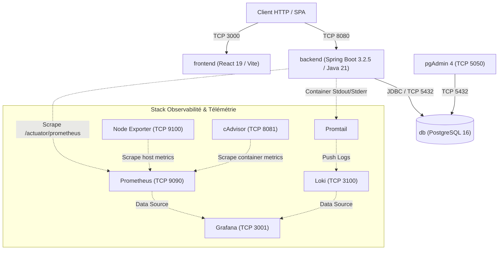

# BanqueSys Solution — Architecture Technique & Stack DevOps

[](https://www.oracle.com/java/)
[](https://spring.io/projects/spring-boot)
[](https://react.dev/)
[](https://vitejs.dev/)
[](https://www.postgresql.org/)
[](https://www.docker.com/)
[](https://prometheus.io/)
[](https://grafana.com/)
[](https://grafana.com/oss/loki/)
[](https://www.sonarqube.org/)

---

## 📑 Sommaire
1. [Architecture Technique Globale](#-architecture-technique-globale)
2. [Stack Technologique & Librairies](#-stack-technologique--librairies)
3. [Services & Conteneurisation (Docker Compose)](#-services--conteneurisation-docker-compose)
4. [Pile d'Observabilité & Métriques](#-pile-dobservabilité--métriques)
5. [Modules Techniques & Intégrations](#-modules-techniques--intégrations)
6. [Structure du Répertoire](#-structure-du-répertoire)
7. [Variables d'Environnement](#-variables-denvironnement)
8. [Déploiement & Commandes](#-déploiement--commandes)
9. [Points d'Accès Réseau & Actuator](#-points-daccès-réseau--actuator)
10. [Analyse Statique & Qualité (SonarQube)](#-analyse-statique--qualité-sonarqube)

---

## 🏛️ Architecture Technique Globale

L'application repose sur une architecture conteneurisée à 3 tiers (Frontend SPA, Backend REST API, Base de données relationnelle) couplée à une stack complète d'observabilité (Métriques, Logs, Monitoring conteneurs et hôte).



---

## 🛠️ Stack Technologique & Librairies

### Backend
- **Runtime** : Java 21 (Eclipse Temurin)
- **Framework** : Spring Boot 3.2.5
- **ORM & Persistance** : Spring Data JPA, Hibernate, PostgreSQL JDBC Driver
- **Sécurité** : Spring Security, JJWT (`jjwt-api`, `jjwt-impl`, `jjwt-jackson` v0.12.5)
- **Monitoring & Instrumentation** : Spring Boot Actuator, Micrometer Prometheus (`micrometer-registry-prometheus`)
- **Mailing** : Spring Boot Mail, Mailtrap Java SDK v1.3.0

### Frontend
- **Runtime & Bundler** : Node.js, Vite 8
- **Framework UI** : React 19, TypeScript
- **Composants** : Material UI (`@mui/material`, `@mui/icons-material` v9), Emotion
- **Gestion d'État & Data Fetching** : Zustand v5, TanStack React Query v5
- **Formulaires & Validation** : React Hook Form v7, Yup v1.7
- **Traitement Client & Médias** :
  - `tesseract.js` v7 (Moteur OCR WebAssembly)
  - `jsqr` v1.4 (Décodage QR code par flux vidéo/canvas)
  - `jspdf` v4.2, `jspdf-autotable` v5 (Génération dynamique de PDF)
  - `axios` v1.15 (Client HTTP)

### Base de Données & Outils
- PostgreSQL 16
- pgAdmin 4

---

## 🐳 Services & Conteneurisation (Docker Compose)

Le fichier `docker-compose.yml` orchestre 8 conteneurs interconnectés via le réseau bridge `banque-sys-network` :

| Conteneur | Image de Base | Ports Mappés | Volumes Persistants | Rôle Technique |
| :--- | :--- | :--- | :--- | :--- |
| `banque-sys-db` | `postgres:16` | `5432:5432` | `postgres_data:/var/lib/postgresql/data` | Serveur de BDD relationnelle |
| `banque-sys-pgadmin` | `dpage/pgadmin4` | `5050:80` | - | Interface d'administration PostgreSQL |
| `banque-sys-backend` | Multi-stage `backend/Dockerfile` | `8080:8080` | - | API REST Spring Boot |
| `banque-sys-frontend` | `frontend/Dockerfile` | `3000:3000` | Local bind mount `/app` | SPA React (mode Vite HMR) |
| `banque-sys-prometheus` | `prom/prometheus:v2.51.2` | `9090:9090` | `prometheus_data:/prometheus` | Moteur TSDB & Collecte PromQL |
| `banque-sys-grafana` | `grafana/grafana:10.4.2` | `3001:3000` | `grafana_data:/var/lib/grafana` | Tableaux de bord & Visualisation |
| `banque-sys-node-exporter`| `prom/node-exporter:v1.7.0` | `9100:9100` | Host `/proc`, `/sys`, `/` (ro) | Métriques système de l'hôte |
| `banque-sys-cadvisor` | `gcr.io/cadvisor/cadvisor:v0.47.2` | `8081:8080` | Docker sock, cgroups (ro) | Métriques CPU/RAM par conteneur |
| `banque-sys-loki` | `grafana/loki:2.9.7` | `3100:3100` | `loki_data:/loki` | Système d'indexation & stockage des logs |
| `banque-sys-promtail` | `grafana/promtail:2.9.7` | - | `/var/lib/docker/containers` (ro) | Agent de scraping des logs conteneurs |

---

## 📊 Pile d'Observabilité & Métriques

### 1. Métriques JVM & Applicatives (Prometheus)
- Configuration de scrape : `devops/prometheus/prometheus.yml`
- Scrape target : `backend:8080/actuator/prometheus`
- Métriques collectées :
  - Métriques JVM : Garbage Collection, Threads, Mémoire Heap/Non-Heap.
  - Métriques HTTP : `http.server.requests` avec histogrammes de latence et percentiles (SLO : 50ms, 100ms, 200ms, 500ms, 1s).
  - Métriques Connexions BDD : HikariCP pool usage, active/idle connections.

### 2. Métriques Infrastructure
- `node-exporter` : Charge CPU, utilisation RAM, E/S disque hôte, trafic réseau.
- `cadvisor` : Consommation de ressources isolée pour chaque conteneur Docker.

### 3. Centralisation des Logs (Loki + Promtail)
- Découverte automatique des conteneurs via le socket Docker (`/var/run/docker.sock`).
- Parsing des flux JSON / textuels et indexation sous Loki.
- Consultation et requêtage via le langage LogQL dans Grafana.

---

## ⚙️ Modules Techniques & Intégrations

Le comportement des modules est commutable via `application.properties` (Sandbox/API réelle vs Mock local) :

```properties
# 1. Intégration Paiement / Approvisionnement
banquesys.service.funding=stripe        # Options: stripe | mock
STRIPE_API_KEY=YOUR_STRIPE_KEY

# 2. Moteur OCR & Analyse d'Images
banquesys.service.kyc=veriff            # Options: veriff (OpenAI Vision API) | mock

# 3. Notification & Passerelle SMS/Email
banquesys.service.notification=real     # Options: real (SMTP/Twilio) | mock
TWILIO_ACCOUNT_SID=
TWILIO_AUTH_TOKEN=

# 4. Traitement NLP & Assistant IA
banquesys.service.chatbot=openai        # Options: openai (GPT-4o-mini API) | mock

# 5. Service FX (Taux de Change)
banquesys.service.exchangerate=api      # Options: api (open.er-api.com) | constant

# 6. Catégorisation Automatique
banquesys.service.categorizer=ai        # Options: ai (GPT-4o-mini) | rule
```

---

## 📂 Structure du Répertoire

```text
banque/
├── backend/
│   ├── src/main/java/com/banquesys/
│   │   ├── config/             # CORS, SecurityFilterChain, ActuatorConfig
│   │   ├── controller/         # 20 Contrôleurs REST
│   │   ├── dto/                # Request/Response DTOs
│   │   ├── model/              # Entités JPA (PostgreSQL)
│   │   ├── repository/         # Interfaces JpaRepository
│   │   ├── security/           # JwtTokenProvider, AuthFilter, SecurityDetails
│   │   └── service/            # Implémentations métier & connecteurs API
│   ├── src/main/resources/     # application.properties
│   ├── Dockerfile              # Build Maven -> JRE 21 multi-stage
│   └── pom.xml                 # Dépendances Maven
├── frontend/
│   ├── src/                    # Composants React, Stores Zustand, Hooks React Query
│   ├── public/                 # Fichiers statiques et modèles OCR (.traineddata)
│   ├── Dockerfile              # Conteneur Node / Vite
│   ├── vite.config.js          # Config Vite
│   └── package.json            # Dépendances npm
├── devops/
│   ├── grafana/provisioning/   # Configuration auto-déployée datasources & dashboards
│   ├── prometheus/             # Configuration Prometheus & règles
│   ├── loki/                   # Configuration Loki
│   └── promtail/               # Configuration Promtail
├── docker-compose.yml          # Définition des services Docker
└── sonar-project.properties    # Paramètres d'analyse SonarQube
```

---

## 🔐 Variables d'Environnement

Exemple de variables pour `.env` ou injection système :

```env
# Clé API OpenAI (pour les modules OCR Vision et Chatbot)
OPENAI_API_KEY=sk-proj-xxxxxxxxxxxxxxxxxxxxxxxx

# Base de données PostgreSQL
POSTGRES_USER=postgres
POSTGRES_PASSWORD=postgres
POSTGRES_DB=banquesysdb

# Sécurité JWT
JWT_SECRET=CleSecreteSignatureJWTDe32CaracteresMinimum!

# Mailtrap (Tests SMTP)
MAILTRAP_USERNAME=
MAILTRAP_PASSWORD=
```

---

## 🚀 Déploiement & Commandes

### Déploiement Complet (Docker Compose)
```bash
# Construction et lancement de l'ensemble de la pile
docker compose up --build -d

# Vérification du statut des services et healthchecks
docker compose ps

# Consultation des logs applicatifs
docker compose logs -f backend frontend
```

### Arrêt de l'Infrastructure
```bash
docker compose down
# Pour supprimer également les volumes de données :
docker compose down -v
```

### Exécution Hors Conteneur (Développement Local)

**Backend** :
```bash
cd backend
./mvnw clean spring-boot:run
```

**Frontend** :
```bash
cd frontend
npm install
npm run dev
```

---

## 🌐 Points d'Accès Réseau & Actuator

| Service | Port | Endpoint URL | Authentification |
| :--- | :--- | :--- | :--- |
| **Frontend Web** | `3000` | `http://localhost:3000` | - |
| **Backend REST API** | `8080` | `http://localhost:8080/api` | Bearer JWT |
| **Actuator Health** | `8080` | `http://localhost:8080/actuator/health` | Public |
| **Actuator Metrics** | `8080` | `http://localhost:8080/actuator/metrics` | Public |
| **Prometheus Exporter**| `8080`| `http://localhost:8080/actuator/prometheus` | Public |
| **Prometheus Web UI** | `9090` | `http://localhost:9090` | Public |
| **Grafana UI** | `3001` | `http://localhost:3001` | `admin` / `admin` |
| **cAdvisor UI** | `8081` | `http://localhost:8081` | Public |
| **pgAdmin 4** | `5050` | `http://localhost:5050` | `admin@banque-sys.com` / `admin` |

---

## 🧪 Analyse Statique & Qualité (SonarQube)

Configuration définie dans `sonar-project.properties` :
- `sonar.projectKey=banquesys`
- `backend.sonar.sources=src/main/java`
- `backend.sonar.tests=src/test/java`
- `backend.sonar.coverage.jacoco.xmlReportPaths=target/site/jacoco/jacoco.xml`
- `frontend.sonar.sources=src`
- `frontend.sonar.typescript.lcov.reportPaths=coverage/lcov.info`

Lancement du scan :
```bash
cd backend
mvn clean test jacoco:report
sonar-scanner -Dsonar.host.url=http://localhost:9000 -Dsonar.login=YOUR_TOKEN
```
